# Diagrama de clases — Sistema de Bicicletas Públicas (v6)

> Para verlo en VS Code: abrí este archivo y usá **Ctrl+Shift+V** (Markdown Preview).
> Mermaid viene soportado de forma nativa en VS Code (1.60+) → no requiere extensiones.

```mermaid
classDiagram

    class Menu {
        -SistemaBicis* sistema
        +iniciarMenu() void
        -mostrarOpcionesDelMenu() void
        -procesarOpcionElegida(int opcion) void
    }

    class SistemaBicis {
        -TablaHash~Estacion*~ estaciones
        -Lista~Viaje*~ viajes
        -Grafo~string~ ciclovias
        -ABB~int, Bicicleta*~ bicicletas
        -HeapMin~Bicicleta*~ taller
        +cargarDatosDesdeArchivos() void
        +mostrarInformacionDeEstacionPorCodigo(string codigo) void
        +agregarEstacion(Estacion* estacion) void
        +eliminarEstacion(string codigo) bool
        +listarEstacionesOrdenadas(int criterio) void
        +listarEstacionesConBajaOcupacion() void
        +mostrarRecorridoMasCorto(string origen, string destino) void
        +mostrarEstadisticasDelHash() void
        +contarViajesDesdeEstacionEnRango(string codigo, int fechaDesde, int fechaHasta) int
        +mostrarViajesYMinutosDeUsuario(int dni) void
        +agregarBicicleta(int id, string codigoEstacion, string tipo, string estado, int kilometros) void
        +buscarBicicletaPorId(int id) Bicicleta*
        +listarBicicletasOrdenadasPorId() void
        +contarBicicletasAveriadas() int
        +listarBicicletasConMasKm(int kmMinimo) void
        +mostrarAlturaDelArbol() void
        +retirarBicicleta(string codigoEstacion, int dni) void
        +devolverBicicleta(string codigoEstacion) void
        +enviarBicicletaAlTaller(int idBicicleta, int prioridad) void
        +repararSiguienteBicicleta() void
        +planificarRedistribucion(int capacidadCamion, string* codigos, int* faltantes, int cantidad) void
        +~SistemaBicis() void
    }

    class Estacion {
        -string codigo
        -string nombre
        -string barrio
        -int capacidadAnclajes
        -int bicisDisponibles
        -Cola~int~ colaEspera
        +getCodigo() string
        +calcularPorcentajeOcupacion() double
        +retirarBicicleta(int dni) bool
        +devolverBicicleta() int
        +mostrarInformacion() void
    }

    class Bicicleta {
        -int id
        -string codigoEstacion
        -string tipo
        -string estado
        -int kilometros
        +getId() int
        +getKilometros() int
        +estaAveriada() bool
        +esElectrica() bool
        +mostrarInformacion() void
    }

    class Viaje {
        -int id
        -int idBici
        -int dniUsuario
        -string estacionOrigen
        -string estacionDestino
        -int fecha
        -int duracionMin
        +getFecha() int
        +getDniUsuario() int
        +getEstacionOrigen() string
        +getDuracionMin() int
        +mostrarInformacion() void
    }

    class Redistribuidor {
        -string* codigos
        -int* faltantes
        -int cantidadEstaciones
        -int capacidadCamion
        -bool* elegidas
        -int cantidadSoluciones
        +buscarSoluciones() int
        -probar(int posicion, int sumaActual) void
        -mostrarSolucion() void
        +~Redistribuidor() void
    }

    class Cola~T~ {
        -NodoCola~T~* primero
        -NodoCola~T~* ultimo
        -int largo
        +encolar(T dato) void
        +desencolar() T
        +verPrimero() T
        +estaVacia() bool
        +obtenerLargo() int
        +~Cola() void
    }

    class Grafo~T~ {
        -VerticeGrafo~T~* primerVertice
        -int cantidadVertices
        +agregarVertice(T dato) void
        +eliminarVertice(T dato) bool
        +agregarArista(T origen, T destino) void
        +existeVertice(T dato) bool
        +caminoMasCorto(T origen, T destino, T* camino, int& largo) bool
        -buscarVertice(T dato) VerticeGrafo~T~*
        -reiniciarMarcas() void
        +~Grafo() void
    }

    class Lista~T~ {
        -NodoLista~T~* primero
        -int largo
        +insertarEnPosicion(T dato, int posicion) void
        +eliminarEnPosicion(int posicion) void
        +obtenerEnPosicion(int posicion) T
        +estaVacia() bool
        +obtenerLargo() int
        +~Lista() void
    }

    class ABB~K,V~ {
        -NodoABB~K,V~* raiz
        -int cantidad
        +insertar(K clave, V dato) bool
        +buscar(K clave, V& resultado) bool
        +eliminar(K clave) bool
        +obtenerEnInorder(V* destino) void
        +calcularAltura() int
        +obtenerCantidad() int
        +estaVacio() bool
        -alturaRecursiva(NodoABB~K,V~* nodo) int
        -liberarPostorder(NodoABB~K,V~* nodo) void
        +~ABB() void
    }

    class HeapMin~T~ {
        -ElementoHeap~T~* elementos
        -int cantidad
        -int capacidad
        +insertar(T dato, int prioridad) void
        +extraerMinimo() T
        +verMinimo() T
        +estaVacio() bool
        +obtenerCantidad() int
        -subirElemento(int posicion) void
        -bajarElemento(int posicion) void
        -agrandarArreglo() void
        +~HeapMin() void
    }

    class TablaHash~V~ {
        -NodoHash~V~** tabla
        -int capacidad
        -int cantidad
        -int colisiones
        +insertar(string clave, V dato) bool
        +buscar(string clave, V& resultado) bool
        +eliminar(string clave) bool
        +obtenerTodos(V* destino) void
        +obtenerCantidad() int
        +obtenerColisiones() int
        +calcularFactorDeCarga() double
        -funcionHash(string clave) int
        +~TablaHash() void
    }

    class NodoCola~T~ {
        -T dato
        -NodoCola~T~* siguiente
        +getDato() T
        +getSiguiente() NodoCola~T~*
        +setSiguiente(NodoCola~T~* nodo) void
    }

    class VerticeGrafo~T~ {
        -T dato
        -AristaGrafo~T~* primeraArista
        -VerticeGrafo~T~* siguiente
        -bool visitado
        -VerticeGrafo~T~* anterior
        +getDato() T
        +agregarAristaHacia(VerticeGrafo~T~* destino) void
        +eliminarAristaHacia(VerticeGrafo~T~* destino) void
        +getPrimeraArista() AristaGrafo~T~*
        +~VerticeGrafo() void
    }

    class NodoLista~T~ {
        -T dato
        -NodoLista~T~* siguiente
        +getDato() T
        +getSiguiente() NodoLista~T~*
        +setSiguiente(NodoLista~T~* nodo) void
    }

    class NodoABB~K,V~ {
        -K clave
        -V dato
        -NodoABB~K,V~* izquierdo
        -NodoABB~K,V~* derecho
        +getClave() K
        +getDato() V
        +getIzquierdo() NodoABB~K,V~*
        +getDerecho() NodoABB~K,V~*
        +setIzquierdo(NodoABB~K,V~* nodo) void
        +setDerecho(NodoABB~K,V~* nodo) void
    }

    class ElementoHeap~T~ {
        -T dato
        -int prioridad
        +getDato() T
        +getPrioridad() int
    }

    class NodoHash~V~ {
        -string clave
        -V dato
        -NodoHash~V~* siguiente
        +getClave() string
        +getDato() V
        +getSiguiente() NodoHash~V~*
        +setSiguiente(NodoHash~V~* nodo) void
    }

    class AristaGrafo~T~ {
        -VerticeGrafo~T~* destino
        -AristaGrafo~T~* siguiente
        +getDestino() VerticeGrafo~T~*
        +getSiguiente() AristaGrafo~T~*
        +setSiguiente(AristaGrafo~T~* arista) void
    }

    Menu "1" --> "1" SistemaBicis : sistema

    SistemaBicis "1" --> "0..*" Estacion : estaciones
    SistemaBicis "1" --> "0..*" Bicicleta : bicicletas
    SistemaBicis "1" --> "0..*" Viaje : viajes
    SistemaBicis ..> Redistribuidor : «usa»

    SistemaBicis "1" *-- "1" Grafo~T~ : «T=string»
    SistemaBicis "1" *-- "1" Lista~T~ : «T=Viaje*»
    SistemaBicis "1" *-- "1" ABB~K,V~ : «K=int, V=Bicicleta*»
    SistemaBicis "1" *-- "1" HeapMin~T~ : «T=Bicicleta*»
    SistemaBicis "1" *-- "1" TablaHash~V~ : «V=Estacion*»

    Estacion "1" *-- "1" Cola~T~ : «T=int»

    Lista~T~ "1" *-- "0..*" NodoLista~T~
    Cola~T~ "1" *-- "0..*" NodoCola~T~
    Grafo~T~ "1" *-- "0..*" VerticeGrafo~T~
    VerticeGrafo~T~ "1" *-- "0..*" AristaGrafo~T~
    AristaGrafo~T~ "0..*" --> "2" VerticeGrafo~T~
    ABB~K,V~ "1" *-- "0..1" NodoABB~K,V~ : raiz
    HeapMin~T~ "1" *-- "0..*" ElementoHeap~T~
    TablaHash~V~ "1" *-- "0..*" NodoHash~V~
```

## Leyenda

- `*--` : composición (rombo relleno; el dueño contiene y libera la parte).
- `-->` : asociación / dependencia.
- `..>` : dependencia (uso).
- `~T~` : parámetro genérico (equivalente a `<T>` en C++).
- `«T=...»` : binding del genérico (instanciación concreta del template).
- `-` privado, `+` público.
